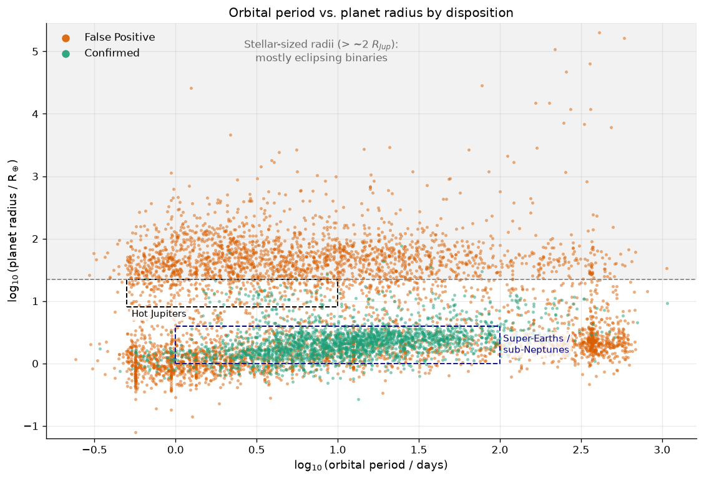
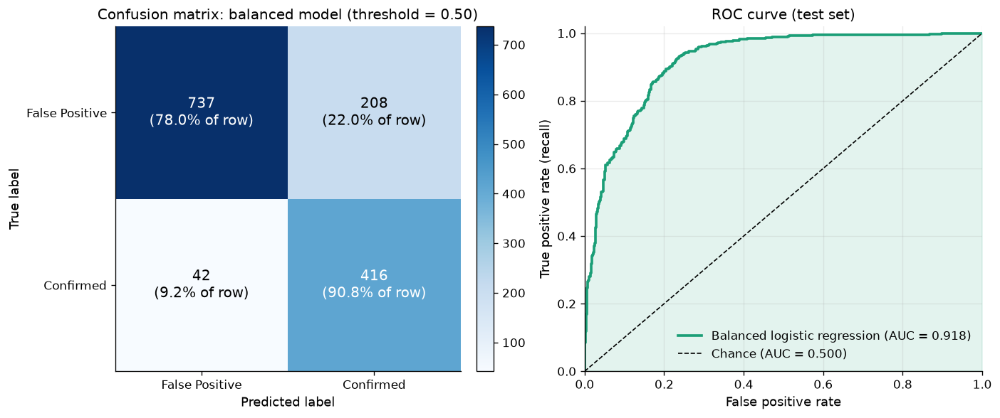

# Kepler Exoplanet Candidate Vetting

Binary logistic regression pipeline to classify NASA Kepler Objects of Interest (KOIs) into **Confirmed Exoplanets** (`1`) versus **False Positives** (`0`) using physical and orbital transit photometry parameters.

Built as a final project for the *Statistical Analysis through Programming* course.

---

## Overview

Periodic dips in stellar brightness detected by the Kepler Space Telescope can result from transiting exoplanets or astrophysical/instrumental false positives (such as eclipsing binary stars). Rather than relying on pre-computed pipeline disposition scores, this project models confirmation probability directly from observable physical parameters:

- **Base Predictors (6):** `koi_period`, `koi_duration`, `koi_prad`, `koi_teq`, `koi_model_snr`, and `koi_steff` (collinear features `koi_insol`, `koi_depth`, and `koi_srad` are excluded to maintain $\text{VIF} < 10$).
- **Engineered Domain Features (2):** Quadratic planetary radius (`log10_koi_prad_sq`) to capture the non-monotonic planetary radius band ($\approx 0.8\text{–}15\,R_\oplus$), and an orbital geometry interaction (`period_x_duration`) capturing $T_{\text{dur}} \propto P^{1/3}$ scaling.
- **Leakage Prevention:** Excludes `koi_score` and all `koi_fpflag_*` columns, as they encode post-vetting diagnostic outputs.
- **Dataset Scope:** Filtered from 9,564 raw KOIs down to **7,015 resolved observations** (32.7% Confirmed, 67.3% False Positives) after removing unverified `CANDIDATE` rows and incomplete records.

---

## Repository Structure

```text
├── kepler_exoplanet_vetting.ipynb   # Main analysis, statistical tests, models, and plots
├── cumulative.csv                   # NASA Kepler KOI dataset (download separately)
├── assets/
│   ├── period_vs_radius.png         # Orbital period vs. planetary radius regime scatter plot
│   └── roc_confusion_matrix.png     # Test-set confusion matrix and ROC curve
└── README.md
```

---

## Methodology

1. **Data Cleaning & Feature Engineering (`pandas`, `numpy`):** Filters resolved KOIs, drops missing/non-positive records, applies `log10` transformations to five right-skewed physical parameters (keeping `koi_steff` linear), and constructs quadratic radius and period–duration interaction terms.
2. **Hypothesis Testing (`scipy.stats`):** Evaluates class separation across the six base features using Welch's *t*-test, Mann-Whitney *U* test, and Cohen's *d* effect sizes with Bonferroni correction ($\alpha = 0.0083$).
3. **Exploratory Visuals (`matplotlib`):** Generates normalized density overlays, an orbital period vs. planetary radius regime scatter plot, and a Pearson correlation / VIF multicollinearity heatmap.
4. **Inferential Modeling (`statsmodels`):** Fits `Logit` on an 80/20 stratified train-test split (`random_state=42`, standardized strictly on training data) to extract standardized coefficients, odds ratios ($\exp(\beta)$), and 95% confidence intervals.
5. **Predictive Evaluation (`scikit-learn`):** Evaluates and compares an unweighted baseline against a class-weighted (`class_weight="balanced"`) logistic regression model on the held-out test set at threshold `0.50`.

---

## Results

### Test-Set Classification Metrics (Threshold = 0.50)

| Metric | Baseline (Unweighted) | Improved (`class_weight="balanced"`) | Change |
|---|---|---|---|
| **Accuracy** | **0.8350** | **0.8220** | `-0.0130` |
| **Precision** | **0.7470** | **0.6670** | `-0.0800` |
| **Recall** | **0.7490** | **0.9080** | `+0.1590` |
| **F1-Score** | **0.7480** | **0.7690** | `+0.0210` |
| **ROC-AUC** | **0.9180** | **0.9190** | `+0.0010` |

*Majority-class baseline accuracy (`FALSE POSITIVE`): **0.6735** | `statsmodels` McFadden Pseudo-$R^2$: **0.480**.*

### Visual Diagnostics





### Key Statistical Findings

- **Transit Signal-to-Noise (`log10_koi_model_snr`, OR = 34.5, 95% CI [26, 46]):** Strongest linear discriminator; high-SNR signals rarely originate from detector noise.
- **Non-Linear Planetary Radius (`log10_koi_prad` OR = 6.5; `log10_koi_prad_sq` negative):** Confirmation log-odds peak near $R_p \approx 1.4\,R_\oplus$ (Super-Earths/Sub-Neptunes) and drop sharply above $\approx 2\,R_{\text{Jup}}$ ($\approx 22\,R_\oplus$), where eclipsing binaries dominate.
- **Orbital Transit Geometry (`log10_koi_period` OR = 37.5; `period_x_duration` OR = 0.23):** Transit duration becomes significant only relative to orbital period ($p < 0.001$ for the interaction vs. $p = 0.44$ for duration alone).
- **Thermal & Stellar Parameters:** Host star temperature (`koi_steff`, OR = 0.32) negatively associates with confirmation, while equilibrium temperature (`koi_teq`, OR = 7.5, 95% CI [4.8, 11.6]) remains well-constrained with $\text{VIF} < 10$ across all base features.

---

## Setup & Usage

1. **Download the Dataset:**
   Download `cumulative.csv` from the [NASA Kepler Exoplanet Search Results dataset on Kaggle](https://www.kaggle.com/datasets/nasa/kepler-exoplanet-search-results) and place it in the root directory.

2. **Install Dependencies:**
   ```bash
   pip install numpy pandas scipy statsmodels scikit-learn matplotlib jupyter
   ```

3. **Run the Notebook:**
   ```bash
   jupyter notebook kepler_exoplanet_vetting.ipynb
   ```
   Execute all cells top-to-bottom (**Kernel > Restart & Run All**).